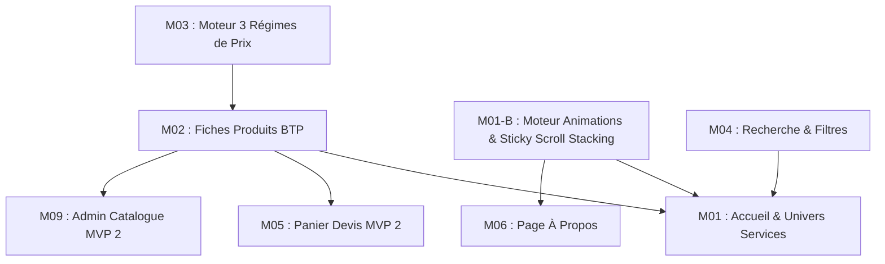

# FICHIER PROJET — SCI GLORIA INVESTMENT & CO
> **Source de vérité unique du projet.**  
> **Dernière mise à jour :** 16 Octobre 2026 | Phase 2 : Cadrage et Fichier Projet  
> **Chef d'orchestre :** [CHEF DE PROJET]

---

## 1. Vision et Objectif du Site (1 phrase)
Créer une plateforme web moderne, animée au scroll et ultra-rapide sur mobile, pour positionner SCI GLORIA INVESTMENT & CO comme le leader de confiance à Abidjan dans la Construction, la Gestion Immobilière et la Vente de Matériaux, en convertissant directement les visiteurs en commandes et devis via WhatsApp Business.

---

## 2. Niche, Secteur, Cible & Offre
* **Entreprise :** SCI GLORIA INVESTMENT & CO (Abidjan, Marcory en bas du pont, près de la pharmacie Tiaco).
* **Secteur :** BTP, Promotion & Gestion Immobilière, Vente de Matériaux et Finitions.
* **Cible :** 
  1. Particuliers bâtisseurs & propriétaires (rénovation, second œuvre, briques de qualité).
  2. Professionnels du bâtiment & artisans (gros volumes, disponibilité stock, approvisionnement chantiers).
  3. Acquéreurs & investisseurs immobiliers (terrains sécurisés, maisons, gestion locative).
* **Offre & 3 Services Clés :**
  1. *Construction :* Chantiers BTP, gros œuvre et unité de fabrication de briques pour la revente.
  2. *Gestion Immobilière :* Terrains titrés, maisons, lotissements et gestion locative.
  3. *Vente de Matériaux de Construction :* Outillage, matériel et produits de finition pour l'habitat.
* **Politique de Prix (3 régimes clairs) :**
  - *Prix Fixe :* Tarif unitaire affiché en FCFA.
  - *Sur Demande :* Badge pour tarif soumis à contact.
  - *Devis Gratuit :* Formulaire / contact pour chiffrage sur mesure sous 24h.

---

## 3. Ton de Marque et Direction Artistique Choisie
* **Ton de Marque :** Professionnel, rigoureux, accessible et rassurant (anti-arnaque, ancrage local fort).
* **Ambiance Visuelle :** BTP Moderne & Premium.
* **Palette :** 
  - Blanc éclatant `#FFFFFF` (dominant, pureté, lisibilité).
  - Bleu Nuit Profond `#0B192C` (structure, élégance corporate, prestige et solidité).
  - Gris Technique `#F3F4F6` & `#9CA3AF` (matériaux, neutralité élégante).
  - Jaune Chantier / Or Doré `#EAB308` / `#F59E0B` (énergie BTP, standing, accents d'action).
* **Typographie Officielle :** **Poppins** (Google Fonts).
  - *Titres & Accroches :* Poppins Bold (700) & SemiBold (600) — géométrique, impactant, moderne.
  - *Prix, Badges & Boutons :* Poppins Medium (500) — lisibilité instantanée des montants et références.
  - *Corps de texte & Fiches techniques :* Poppins Regular (400) — net et confortable sur tous les écrans mobiles.
* **Expérience Dynamique :** Effets de défilement (*scroll reveal*), **Sticky Scroll / Stacking Sections** (cartes de services qui s'empilent au scroll façon Apple/Stripe), compteurs animés et micro-interactions soignées sans perte de vitesse sur mobile.

---

## 4. Stack Technique Choisie et Justification
* **Framework :** React 19 / Next.js (rapidité, référencement SEO performant, architecture moderne).
* **Styles :** Tailwind CSS (flexibilité, design sur mesure, conformité design system).
* **Composants & Icônes :** shadcn/ui & Lucide Icons (légèreté, accessibilité WCAG AA, robustesse).
* **Animations :** CSS Sticky pur (`position: sticky` avec empilement `z-index` naturel) + micro-transitions Tailwind, pour un effet Stacking Sections sans lourdeur JS.
* **Backend & Données :** Approche progressive (données statiques typées en MVP 1, BaaS Neon/Firebase pour le back-office en MVP 2 et MVP 3).
* **Sécurité :** OWASP Top 10, protection anti-scraping IA, mécanisme de *Soft Delete* (suppression logique sans destruction définitive de données).

---

## 5. Architecture Modulaire Détaillée & Dépendances

### Arborescence des Pages et Routes (MVP 1)
* `/` : **Accueil Haute Conversion** (Hero animé, **Stacking Sections des 3 Univers de Services**, Produits phares, Réassurance Marcory, Chiffres clés animés).
* `/services/construction` : **Pôle BTP & Briques** (Travaux, unité de fabrication, devis chantier).
* `/services/immobilier` : **Pôle Immobilier** (Terrains sécurisés, maisons, gestion locative).
* `/services/materiaux` : **Pôle Matériaux & Finitions** (Outillage, second œuvre, quincaillerie).
* `/catalogue` : **Catalogue Global Filtrable** (Recherche par mot-clé, tri par univers, filtre disponibilité).
* `/produit/[slug]` : **Fiche Technique BTP** (Photos, vidéo, dimensions/résistance, 3 types de prix, bouton WhatsApp dédié).
* `/a-propos` : **Crédibilité & Savoir-Faire** (Histoire, entrepôt Marcory, équipe, démarche qualité).
* `/contact` : **Localisation & Prise de Rendez-vous** (Plan d'accès Marcory, formulaire, horaires, bouton direct WhatsApp).
* `/mentions-legales` : **Conformité OHADA / Côte d'Ivoire**.

### Matrice des Dépendances entre Modules

### Statut Détaillé des Modules
| ID | Nom du Module | Priorité | Dépendance | Statut |
| :--- | :--- | :--- | :--- | :--- |
| `M01` | Page d'Accueil Haute Conversion (3 Pôles Services) | Indispensable | M01-B, M02 | Prêt pour Design |
| `M01-B` | Moteur d'Animations & Sticky Scroll Stacking | Indispensable | Aucun | Prêt pour Design |
| `M02` | Fiche Technique Produit/Service & Partage Direct WhatsApp | Indispensable | M03 | Prêt pour Design |
| `M03` | Moteur des 3 Régimes de Prix (Fixe / Demande / Devis) | Indispensable | Aucun | Prêt pour Design |
| `M04` | Recherche Textuelle & Filtres Rapides | Indispensable | M02 | Prêt pour Design |
| `M05` | Panier de Devis Groupé vers WhatsApp | Important | M02 | Prévu (MVP 2) |
| `M06` | Page "À Propos" & Ancrage Marcory | Indispensable | M01-B | Prêt pour Design |
| `M07` | Page Contact Hybride (Plan Marcory, WhatsApp, Horaires) | Indispensable | Aucun | Prêt pour Design |
| `M08` | SEO Local Abidjan (Schema.org, OpenGraph, sitemap, llm.txt) | Indispensable | M01, M02 | Prêt pour Design |
| `M09` | Espace Administrateur : Gestion Catalogue & Soft Delete | Important | M02, M14 | Prévu (MVP 2) |
| `M10` | Gestion de Stock & Alertes Visuelles de Rupture | Important | M09 | Prévu (MVP 2) |
| `M11` | Espace Agent Commercial & Suivi des Demandes WhatsApp | Important | M09 | Prévu (MVP 3) |
| `M12` | Comptes Clients & Espace Personnel | Bonus | M11 | Prévu (MVP 3) |
| `M13` | Tableaux de Bord & Statistiques de Vente | Bonus | M11 | Prévu (MVP 3) |
| `M14` | Sécurité OWASP, Anti-scraping & Intégrité des Données | Indispensable | Transverse | Prêt pour Design |
| `M15` | Mentions Légales & Conformité Droit Ivoirien | Indispensable | Aucun | Prêt pour Design |

---

## 6. Roadmap MVP et Séquençage des Tâches

### Séquençage Opérationnel du MVP 1 (Vitrine Vendeuse, Dynamique & WhatsApp) — 100% VALIDÉ
Toutes les micro-tâches ont été réalisées, testées et validées individuellement :

1. **`MVP1-T01` : Initialisation du Socle Technique & Design Tokens** — **VALIDÉ** (Next.js 15, React 19, Tailwind, Poppins, Tokens).
2. **`MVP1-T02` : Données Structurées des 3 Services & Catalogue BTP Initial** — **VALIDÉ** (TypeScript strict, 8 produits, moteur WhatsApp).
3. **`MVP1-T03` : Barre de Navigation, Footer & Bouton Flottant WhatsApp** — **VALIDÉ** (Menu sticky, footer 4 colonnes, widget officiel).
4. **`MVP1-T04` : Section Héro Haute Conversion & Réassurance Marcory** — **VALIDÉ** (Titre éditorial, 4 compteurs animés natifs).
5. **`MVP1-T05` : Stacking Sections des 3 Univers de Services (Effet Sticky Scroll)** — **VALIDÉ** (Empilement CSS pur 60 FPS, CTA dédiés).
6. **`MVP1-T06` : Grille Produits Phares & Moteur des 3 Régimes de Prix** — **VALIDÉ** (Filtres réactifs, prix fixe/demande/devis, stock).
7. **`MVP1-T07` : Fiche Technique Détaillée BTP & Bouton Copie de Lien** — **VALIDÉ** (Pages `/produit/[slug]`, specs, bouton 1 clic).
8. **`MVP1-T08` : Pages Institutionnelles & Contact Marcory (Plan, Horaires)** — **VALIDÉ** (`/a-propos`, `/contact`, Maps, formulaire WhatsApp).
9. **`MVP1-T09` : SEO Local Abidjan & Sécurité Transverse** — **VALIDÉ** (Schema.org JSON-LD, sitemap.xml, robots.txt, llm.txt, mentions légales).
10. **`MVP1-T10` : Recette QA Mobile, Performance & Validation Lancement** — **TERMINÉE & PRÊTE** (Build production 0 erreur, 17 pages SSG, First Load JS ~103 kB, contrastes WCAG AA).

---

---

### MVP 2 : Gestion Catalogue & Devis Multi-produits
1. **`MVP2-T01` : Panier de Devis Groupé avec Quantités (`M05`)** — **TERMINÉ & TESTABLE** :
   - Réglage des quantités par article (`-`, `+`, ou saisie directe du nombre).
   - Raccourcis gros volumes pour les briques (500, 1 000, 2 000, 5 000 unités).
   - Calcul automatique du sous-total par ligne et du total global estimé en FCFA.
   - Message de devis officiel complet envoyé en 1 clic sur WhatsApp Business.
2. **`MVP2-T04` : Barre de Recherche Instantanée dans le Catalogue (`M04-B`)** — **TERMINÉ & TESTABLE** :
   - Recherche en temps réel par mot-clé (nom, sous-catégorie, caractéristiques techniques, cotes).
   - Bouton d'effacement rapide et compteur de résultats trouvés.
   - Mode Carrousel Horizontal Mobile (`M04-C`) : Défilement tactile de gauche à droite sur mobile pour parcourir les articles sans allonger la page verticalement, avec bouton "Voir plus" vers chaque fiche dédiée.
3. **`MVP2-T05` : Simulateur & Calculateur de Matériaux BTP (`M10-B`)** — **TERMINÉ & TESTABLE** :
   - Calculateur de briques (15x20x40 cm) au m² avec marge de casse et sacs de ciment estimés.
   - Calculateur de carrelage 60x60 cm au m² avec calcul automatique en cartons (1.44 m²/carton) et marge de découpes.
   - Bouton d'ajout direct du volume calculé au Panier de Devis (`Commande & Devis`).
4. **`EXP-01` : Page de Chargement Immersive & Restauration Stacking Cards** — **TERMINÉ & TESTABLE** :
   - Écran de chargement ultra-premium corporate (emblème architectural vectoriel or 24K, trame de précision BTP, jauge laser dorée 0-100%, fondu de sortie cinéma).
   - Scroll Stacking Hybride : Cartes 01 & 02 empilées verticalement du bas vers le haut, et Carte 03 (Matériaux) glissant horizontalement de la droite vers la gauche au défilement pour se superposer au stack.
   - Animation de vague de gauche à droite sur les textes du Hero (`HeroSection.tsx`) à la sortie du chargement (apparition mot par mot, vague SVG dorée fluide et brillance lumineuse).
5. **`MVP2-T02` : Espace Administrateur Simple (`M09`)** — *À venir*.
6. **`MVP2-T03` : Gestion Rapide des Stocks & Disponibilités (`M10`)** — *À venir*.

---

### Phases Suivantes (Prévues)
* **MVP 3 : Dashboards Multi-rôles & Statistiques** (`M11` Espace Agent & suivi des paiements, `M12` Espace Client, `M13` Statistiques).
* **MVP 4 : Évolutions Avancées** (Carte interactive des lotissements, calculateur de matériaux BTP).

---

## 7. Journal des Décisions
* **16/10/2026 :** Arbitrage sur le paiement en ligne. Décision : Zéro paiement automatique par carte bancaire. Redirection intégrale vers WhatsApp Business pour un contact direct avec l'équipe commerciale locale.
* **16/10/2026 :** Validation de l'approche progressive. Décision : Lancement rapide d'un MVP 1 vitrine performante et conversion WhatsApp, back-office admin en MVP 2, dashboards agent/client en MVP 3.
* **16/10/2026 :** Définition des 3 piliers de services officiels. Décision : Construction (avec briques), Gestion Immobilière, Vente de Matériaux de Construction.
* **16/10/2026 :** Intégration d'un système dynamique au scroll. Décision : Ajout du sous-module `M01-B` pour des animations au défilement modernes tout en préservant la vitesse mobile.
* **16/10/2026 :** Décision d'ajouter l'effet **Sticky Scroll / Stacking Sections** : Les 3 grands services s'empilent au fur et à mesure du défilement avec un effet de superposition ultra-moderne (style Apple/Stripe), réalisé en CSS performant sans ralentir le mobile.
* **16/10/2026 :** Typographie validée : **Poppins** (Google Fonts) choisie comme police unique et complète (Bold 700 pour les titres d'impact, SemiBold 600, Medium 500 pour prix/boutons et Regular 400 pour les textes).
* **16/10/2026 :** Palette validée : Blanc dominant, **Bleu Nuit Profond** (`#0B192C` au lieu de Noir Nuit pour un rendu corporate haut standing), Gris technique et Jaune chantier / Or.

---

## 8. Glossaire et Acquis
* **Vibe Coder :** Créateur qui conçoit et assemble des produits numériques rapidement avec l'aide d'assistants IA et des briques de code modulaires.
* **MVP (Produit Minimum Viable) :** La première version fonctionnelle et présentable du site, qui contient le strict nécessaire pour commencer à vendre sans surplus inutile.
* **Scroll Reveal :** Technique d'animation où les composants visuels apparaissent avec élégance à mesure que l'utilisateur fait défiler la page.
* **Soft Delete :** Technique de base de données où un élément supprimé n'est pas effacé physiquement, mais marqué comme masqué pour conserver la traçabilité.
* **Schema.org :** Balisage invisible inséré dans le code pour que Google comprenne l'adresse physique, les horaires et les services de l'entreprise locale.

---

## 9. Points Ouverts
* Collecte des premiers médias réels de SCI GLORIA (photos de l'entrepôt de Marcory, de l'unité de briques et logo officiel) pour la phase de design.
