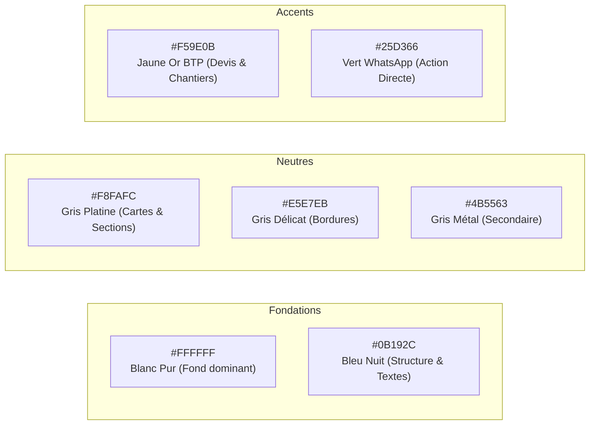

# DESIGN_SYSTEM.md — Guide UX/UI & Identité Visuelle
# SCI GLORIA INVESTMENT & CO

> **Projet :** Plateforme Web E-commerce Vitrine, Devis & Services BTP  
> **Client :** SCI GLORIA INVESTMENT & CO (Abidjan, Marcory)  
> **Auteur :** [DIRECTEUR ARTISTIQUE / UI DESIGNER] & [UX DESIGNER]  
> **Norme d'Accessibilité :** WCAG 2.1 Niveau AA Conforme

---

## 1. Philosophie & Univers Graphique

L'identité visuelle de **SCI GLORIA INVESTMENT & CO** incarne le **BTP Moderne de Haut Standing** :
* **Solidité & Sérieux :** Évoqués par le **Bleu Nuit Profond**, symbole de puissance institutionnelle et de pérennité.
* **Lumière & Clarté :** Assurées par le **Blanc Pur dominant**, offrant une respiration maximale et éliminant tout sentiment de surcharge.
* **Énergie Chantier & Valeur :** Apportées avec parcimonie par le **Jaune Or BTP**, qui dynamise les éléments clés et incite à l'action.
* **Conversion Immédiate :** Marquée par le **Vert Officiel WhatsApp**, canal exclusif d'échange commercial direct.

---

## 2. Palette de Couleurs & Ratios de Contraste (WCAG AA)



### Table des Spécifications Couleurs
| Rôle | Nom | Valeur HEX | Contraste sur Blanc | Utilisation Principale |
| :--- | :--- | :--- | :--- | :--- |
| **Fond Principal** | Blanc Pur | `#FFFFFF` | 1:1 (base) | Arrière-plan général, respiration visuelle. |
| **Fond Secondaire** | Gris Platine | `#F8FAFC` | 1.05:1 | Arrière-plan des cartes et sections alternées. |
| **Structure & Titres** | Bleu Nuit Profond | `#0B192C` | **17.8:1** (AAA) | En-tête, grands titres, cartes institutionnelles. |
| **Texte Secondaire** | Gris Métal | `#4B5563` | **7.1:1** (AAA) | Fiches techniques, descriptions, références. |
| **Bordures** | Gris Délicat | `#E5E7EB` | N/A | Lignes de séparation fines (1px), contours discrets. |
| **Accent Action BTP** | Jaune Or Chantier | `#F59E0B` | **10.1:1** (sur Bleu Nuit) | Boutons de devis, badges promotions, icônes clés. |
| **Accent WhatsApp** | Vert Officiel WA | `#25D366` | **3.8:1** (avec texte blanc gras) | Boutons d'action "Commander / Échanger sur WhatsApp". |

---

## 3. Typographie Officielle : Poppins (Google Fonts)

La police unique retenue est **Poppins**, choisie pour sa géométrie pure, son modernisme et sa lisibilité exceptionnelle sur écran mobile.

```css
@import url('https://fonts.googleapis.com/css2?family=Poppins:wght@400;500;600;700&display=swap');

font-family: 'Poppins', -apple-system, BlinkMacSystemFont, 'Segoe UI', Roboto, sans-serif;
```

### Échelle Typographique Responsiviste
* **Hero H1 (Grand Titre) :**  
  * Desktop : `56px` | Mobile : `36px` | Graisse : `Bold (700)` | Interligne : `1.15`  
  * *Règle :* Toujours en Bleu Nuit avec accents en Jaune Or.
* **Titre de Section H2 :**  
  * Desktop : `36px` | Mobile : `26px` | Graisse : `SemiBold (600)` | Interligne : `1.25`
* **Titre de Carte / Produit H3 :**  
  * Desktop : `20px` | Mobile : `18px` | Graisse : `SemiBold (600)` | Interligne : `1.3`
* **Prix & Badges :**  
  * Taille : `16px` à `18px` | Graisse : `Medium (500)` ou `Bold (700)`
* **Boutons & CTA :**  
  * Taille : `15px` à `16px` | Graisse : `Medium (500)` | Lettres espacées (`tracking-wide`)
* **Corps de Texte (Body) :**  
  * Desktop : `16px` | Mobile : `15px` | Graisse : `Regular (400)` | Interligne : `1.6` (`leading-relaxed`)

---

## 4. Composants Clés & Règles de Design

### 4.1 Effet Sticky Scroll / Stacking Sections (M01-B)
* **Objectif :** Présenter les 3 grands services (Construction, Gestion Immobilière, Vente de Matériaux) avec un effet d'empilement spectaculaire au scroll.
* **Règles CSS :**
  ```css
  .stacking-card {
    position: sticky;
    top: 96px; /* Décalage sous le header */
    margin-bottom: 24px;
    border-radius: 24px;
    background: #FFFFFF;
    border: 1px solid #E5E7EB;
    box-shadow: 0 20px 40px -15px rgba(11, 25, 44, 0.08);
    transition: transform 0.3s ease, box-shadow 0.3s ease;
  }
  ```
* Chaque carte superposée possède un `z-index` croissant (`z-10`, `z-20`, `z-30`) et une légère ombre portée d'élévation.

### 4.2 Boutons d'Action (CTA)
1. **Bouton WhatsApp Primaire :**
   * Fond : `#25D366` | Texte : `#FFFFFF` (Gras)
   * Icône : SVG WhatsApp officiel (taille 20px)
   * Rayon de courbure : `rounded-xl` (12px)
   * Hover : Légère élévation (`translate-y-[-2px]`) et ombre lumineuse verte.
2. **Bouton Devis / Contact BTP :**
   * Fond : `#F59E0B` | Texte : `#0B192C` (Bleu Nuit gras)
   * Rayon : `rounded-xl` (12px)
3. **Bouton Secondaire Fiche Technique :**
   * Fond : Transparent | Bordure : `1.5px solid #E5E7EB` | Texte : `#0B192C`
   * Hover : Fond `#F8FAFC`, bordure `#0B192C`.

### 4.3 Badges des 3 Régimes de Prix
* **Prix Fixe :** Badge vert d'eau discret avec montant en FCFA (`bg-emerald-50 text-emerald-700 border-emerald-200`).
* **Prix Sur Demande :** Badge bleu nuit élégant (`bg-slate-100 text-[#0B192C] border-slate-300`).
* **Devis Gratuit :** Badge ambre doré (`bg-amber-50 text-amber-800 border-amber-200`).

### 4.4 Widget Flottant WhatsApp
* Position : Fixe en bas à droite (`bottom-6 right-6`), `z-50`.
* Rond de 56px de diamètre, vert WhatsApp `#25D366`, avec animation de pulsation subtile pour attirer le regard sans agresser l'utilisateur.

---

## 5. Espacements, Grilles & Mobile-First

* **Échelle d'espacement modulaire (base 4px) :**
  * Micro (gap entre icône et texte) : `8px` (`gap-2`)
  * Padding cartes : `20px` (mobile) / `32px` (desktop)
  * Espacement entre sections : `64px` (mobile) / `96px` à `120px` (desktop)
* **Système de grille (Catalogue) :**
  * Mobile (< 640px) : 1 colonne pleine largeur avec grandes photos tactiles.
  * Tablette (640px - 1024px) : 2 colonnes équilibrées.
  * Desktop (> 1024px) : 3 à 4 colonnes régulières avec filtres latéraux.
