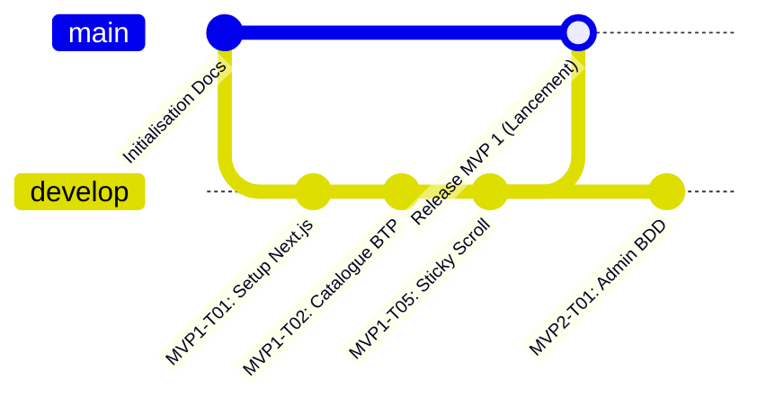

# GITHUB.md — Guide Git, GitHub & Bonnes Pratiques de Versioning
# SCI GLORIA INVESTMENT & CO

> **Projet :** Plateforme Web E-commerce Vitrine, Devis & Services BTP  
> **Auteur :** [DÉVELOPPEUR FRONT] & [CHEF DE PROJET]  
> **Objectif :** Standard professionnel de versioning, traçabilité et collaboration pour le vibe coder.

---

## 1. Initialisation du Dépôt Local Git

Pour initialiser le dépôt Git et créer la branche principale `main` :

```bash
# 1. Initialiser git dans le projet
git init

# 2. Définir la branche par défaut en "main"
git branch -M main

# 3. Configurer l'identité du développeur (si pas encore fait)
git config user.name "Votre Nom"
git config user.email "votre-email@example.com"
```

---

## 2. Le Fichier `.gitignore` Essentiel

Un fichier `.gitignore` strict est placé à la racine pour ne **JAMAIS** pousser sur GitHub les fichiers temporaires, les dépendances lourdes ou les clés secrètes :

```gitignore
# Dépendances Node.js (ne jamais pousser)
node_modules/
.pnp
.pnp.js

# Build et cache Next.js
.next/
out/
build/
dist/

# Fichiers d'environnement & Secrets (CRITIQUE pour la sécurité)
.env
.env.local
.env.development.local
.env.test.local
.env.production.local

# Logs
npm-debug.log*
yarn-debug.log*
yarn-error.log*
.pnpm-debug.log*

# Fichiers OS & IDE
.DS_Store
Thumbs.db
.vscode/
.idea/
```

---

## 3. Règle d'Or : 1 Commit par Micro-Tâche Validée

Pour garder un historique limpide, restaurable et professionnel :
* **Quand commiter ?** Dès qu'une micro-tâche est testée et validée par le mot **"VALIDÉ"**.
* **Norme des messages :** Utilisation des **Conventional Commits** pour une clarté immédiate.

### Format des Messages de Commit
```
<type>(<périmètre>): <identifiant tâche> - <description courte et claire>
```

### Types Autorisés
* `feat` : Nouvelle fonctionnalité ou composant visuel (ex: `feat(mvp1): MVP1-T05 - Intégration Sticky Scroll des 3 services`)
* `docs` : Documentation, PRD, guides (ex: `docs(archi): Création des bibles fonctionnelles et techniques dans docs/`)
* `style` : Ajustement purement visuel (ex: `style(design): Passage de la couleur principale en Bleu Nuit`)
* `fix` : Correction d'un bug ou ajustement de responsive (ex: `fix(mobile): Correction padding header sur iPhone`)
* `chore` : Configuration d'outils, dépendances npm, git (ex: `chore(setup): Initialisation projet Next.js et Tailwind`)

---

## 4. Stratégie de Branches (Git Flow Simplifié)



* **`main` :** Branche de production. Tout ce qui est sur `main` doit être 100% stable, testé et déployable chez les clients.
* **`develop` :** Branche de travail où s'accumulent les micro-tâches validées avant la mise en ligne officielle.

---

## 5. Connexion à GitHub & Premier Envoi (Push)

Le dépôt distant officiel de SCI GLORIA est configuré sur :  
🔗 **`https://github.com/krsidoine7-svg/SCI-GLORIA.git`**

```bash
# 1. Le lien remote origin est déjà configuré :
git remote -v
# origin  https://github.com/krsidoine7-svg/SCI-GLORIA.git (fetch)
# origin  https://github.com/krsidoine7-svg/SCI-GLORIA.git (push)

# 2. Pour pousser vos commits vers GitHub depuis votre terminal :
git push -u origin main
```

---

## 6. Bonnes Pratiques de Sécurité Git

1. **Zéro mot de passe ou clé API en clair :** Aucune clé privée Neon, Firebase ou numéro confidentiel ne doit être écrit en dur dans le code source. Utilisez toujours les variables d'environnement (`process.env.VARIABLE`).
2. **Relecture avant `git add` :** Toujours vérifier les fichiers modifiés avec `git status` et `git diff` avant d'ajouter.
3. **Branches protégées :** Sur GitHub, activer la protection de la branche `main` pour interdire les suppressions accidentelles (`force push`).
