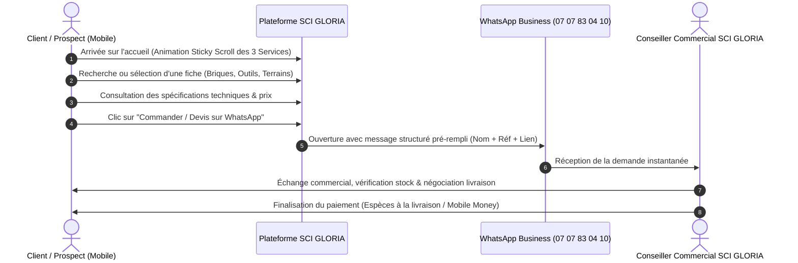

# PRD — Product Requirements Document
# SCI GLORIA INVESTMENT & CO

> **Projet :** Plateforme Web E-commerce Vitrine, Devis & Services BTP  
> **Client :** SCI GLORIA INVESTMENT & CO  
> **Localisation :** Marcory en bas du pont, près de la pharmacie Tiaco, Abidjan, Côte d'Ivoire  
> **WhatsApp Business :** `+225 07 07 83 04 10`  
> **Date :** Octobre 2026 | **Version :** 1.0  
> **Responsable :** [CHEF DE PROJET] & [STRATÈGE BUSINESS]

---

## 1. Contexte & Problématique

### 1.1 Contexte
À Abidjan, le secteur du bâtiment, de la promotion immobilière et de la distribution de matériaux connaît une croissance rapide. Cependant, le marché souffre de deux freins majeurs :
1. **L'opacité des prix et l'incertitude sur la qualité des matériaux** (notamment sur la résistance des briques et la disponibilité réelle en stock).
2. **La méfiance envers les paiements automatisés par carte bancaire en ligne**, la majorité des transactions se concluant après échange humain direct, visite sur place ou par Mobile Money / espèces à la livraison.

### 1.2 Mission de SCI GLORIA
SCI GLORIA INVESTMENT & CO dispose d'une infrastructure physique réelle (magasin et entrepôt de stockage à Marcory, unité de fabrication de briques). La plateforme web a pour mission d'apporter une vitrine digitale de standing international, fluide sur mobile, qui valorise cette crédibilité physique et transforme immédiatement les visiteurs en prospects chauds via **WhatsApp Business**.

---

## 2. Objectifs du Produit & KPI

### 2.1 Objectifs Business
* **Génération de leads qualifiés :** Maximiser les clics vers WhatsApp avec un message pré-rempli contenant la référence exacte du produit ou du service.
* **Crédibilité & Réassurance :** Mettre en avant l'adresse physique à Marcory, les horaires d'ouverture et les photos réelles de l'entrepôt pour éradiquer tout doute d'arnaque.
* **Outil commercial d'appui :** Permettre aux agents de SCI GLORIA de copier et partager le lien direct d'une fiche technique détaillée à un prospect WhatsApp en 1 seconde.

### 2.2 KPI de Succès (Indicateurs Clés)
* **Taux de clic WhatsApp :** > 12% des visiteurs uniques sur les fiches produits et services.
* **Vitesse de chargement mobile :** Score Google Lighthouse Performance > 90/100 sur réseau mobile 3G/4G local.
* **Temps de prise de contact :** Moins de 3 clics entre l'arrivée sur le site et l'ouverture de WhatsApp.

---

## 3. Les 3 Grands Pôles de Services Officiers

Le produit s'articule obligatoirement autour de 3 piliers d'activités clairement dissociés :

### 3.1 🏗️ Construction & Fabrication de Briques
* **Activités :** Gros œuvre, maçonnerie générale, chantiers clés en main, rénovation lourde.
* **Unité de production :** Fabrication industrielle de briques creuses et pleines (10cm, 15cm, 20cm, briques de chaînage, pavés) pour la revente aux particuliers et l'approvisionnement des chantiers.
* **Fiches techniques associées :** Dimensions, dosage, résistance à la compression, conditionnement, disponibilité immédiate en usine.

### 3.2 🏢 Gestion Immobilière & Promotion
* **Activités :** 
  * Vente de terrains sécurisés avec documents légaux (ACD, attestations villageoises approuvées).
  * Vente et location de villas et appartements.
  * Programmes de lotissements viabilisés.
  * Gestion locative et syndic pour les propriétaires bailleurs et la diaspora.

### 3.3 🛠️ Vente de Matériaux de Construction & Finitions
* **Activités :** Fourniture de quincaillerie de chantier, outillage électroportatif et manuel, plomberie, électricité, carrelage, peintures et articles de finition haut de gamme.
* **Point de retrait & livraison :** Magasin et entrepôt de Marcory en bas du pont, avec logistique de livraison sur chantier partout à Abidjan et périphérie.

---

## 4. Politique des 3 Régimes de Prix

Pour garantir une transparence totale et lever les objections, chaque article ou service est obligatoirement rattaché à l'un des 3 régimes :

| Régime | Affichage sur le site | Comportement UX & CTA |
| :--- | :--- | :--- |
| **1. Prix Fixe** | Montant exact en FCFA (ex: `350 FCFA / unité`) | Bouton vert **"Commander sur WhatsApp"** avec quantité souhaitée. |
| **2. Sur Demande** | Badge élégant *"Prix sur demande"* | Bouton **"Consulter le tarif via WhatsApp"** (pour prix fluctuants comme le fer ou le ciment). |
| **3. Devis Gratuit** | Badge *"Devis Gratuit sous 24h"* | Bouton **"Demander un devis personnalisé"** (pour chantiers, gros volumes ou gestion locative). |

---

## 5. Parcours Utilisateur & Expérience d'Achat

---

## 6. Spécifications Fonctionnelles des Modules (M01 à M15)

### `M01` : Page d'Accueil Haute Conversion
* Hero section avec proposition de valeur claire.
* **Stacking Sections (`M01-B`) :** Les 3 grands services s'empilent au défilement (effet Sticky Scroll) avec micro-interactions.
* Compteurs dynamiques animés au scroll (chantiers réalisés, briques produites, années de présence).
* Produits vedettes et arrivages.
* Bloc de réassurance locale (Marcory en bas du pont, près pharmacie Tiaco, horaires Lundi-Vendredi 8h-17h, Samedi demi-journée).

### `M02` : Fiche Technique Produit & Partage Direct
* Galerie photos haute définition et intégration vidéo possible.
* Tableau des caractéristiques techniques (dimensions, résistance, usage).
* Bouton d'action WhatsApp avec message pré-formaté.
* Bouton **"Copier le lien"** en 1 clic avec confirmation visuelle toast.

### `M03` : Moteur des 3 Régimes de Prix
* Affichage conditionnel des composants selon le type de prix (*Fixe*, *Sur demande*, *Devis*).

### `M04` : Recherche & Filtres Rapides
* Barre de recherche par mot-clé textuel.
* Filtre instantané par pôle d'activité et par disponibilité.

### `M06` & `M07` : Pages Institutionnelles & Contact
* Présentation de l'entreprise, des installations de production et des valeurs de solidité.
* Coordonnées complètes, plan d'accès interactif à Marcory, liens directs d'appel et WhatsApp.

### `M08` : SEO Local Abidjan & IA
* Données structurées Schema.org (`LocalBusiness`, `Store`, `GeneralContractor`).
* Balises OpenGraph dynamiques pour prévisualisation riche dans les conversations WhatsApp.
* Fichiers `robots.txt`, `sitemap.xml` et `llm.txt`.

### `M14` & `M15` : Sécurité & Droit Ivoirien
* Conformité OWASP Top 10, protection anti-scraping des catalogues par bots.
* Mentions légales conformes au droit ivoirien / OHADA.
* Mécanisme de *Soft Delete* (suppression logique) pour toutes les données gérées.

---

## 7. Phasage des Livraisons (Roadmap Produit)

* **MVP 1 (Sprint 1) :** Vitrine Dynamique, Fiches BTP, Sticky Scroll & WhatsApp Direct.
* **MVP 2 (Sprint 2) :** Panier de devis groupé (`M05`), Espace Admin catalogue (`M09`), Gestion de stocks & alertes (`M10`).
* **MVP 3 (Sprint 3) :** Espace Agents (`M11`), Espace Clients (`M12`), Statistiques de ventes (`M13`).
* **MVP 4 (Sprint 4) :** Cartographie interactive des parcelles et lotissements, alertes automatisées.
