# ROADMAP.md — Plan de Bataille & Découpage Opérationnel
# SCI GLORIA INVESTMENT & CO

> **Projet :** Plateforme Web E-commerce Vitrine, Devis & Services BTP  
> **Client :** SCI GLORIA INVESTMENT & CO (Abidjan, Marcory)  
> **Auteur :** [CHEF DE PROJET]  
> **Méthode :** Agile / MVP Modulaire (Équipe d'Experts Web)

---

## 1. Vue Stratégique des Phases (PRD → Versions)

```mermaid
graph LR
    subgraph MVP1["Sprint 1 : MVP 1"]
        direction TB
        M01[Accueil & Services]
        M01B[Sticky Scroll Stacking]
        M02[Fiches BTP & Partage]
        M03[3 Régimes de Prix]
        M07[Contact Marcory & WA]
    end

    subgraph MVP2["Sprint 2 : MVP 2"]
        direction TB
        M05[Panier Devis Groupé]
        M09[Admin Catalogue]
        M10[Stocks & Alertes]
    end

    subgraph MVP3["Sprint 3 : MVP 3"]
        direction TB
        M11[Espace Agent & Statuts]
        M12[Espace Client]
        M13[Stats Ventes]
    end

    subgraph MVP4["Sprint 4 : MVP 4"]
        direction TB
        M14B[Carte Interactive Terrains]
        M15B[Alertes WhatsApp Automatisées]
    end

    MVP1 --> MVP2 --> MVP3 --> MVP4
```

---

## 2. Découpage Détaillé du MVP 1 (Les 10 Micro-Tâches)

| ID Tâche | Titre & Périmètre | Durée Estimée | Livrable & Résultat Visible |
| :--- | :--- | :--- | :--- |
| **`MVP1-T01`** | **Initialisation du Socle Technique & Tokens** | 20 min | Next.js 15, Tailwind configuré avec Bleu Nuit `#0B192C`, Blanc `#FFFFFF`, Jaune Or `#F59E0B`, police Poppins active. |
| **`MVP1-T02`** | **Modèle TypeScript & Catalogue BTP Initial** | 20 min | Fichier de données typé contenant les fiches modèles (Briques 15cm/20cm, Outils finitions, Terrains avec dimensions et prix). |
| **`MVP1-T03`** | **Navigation, Footer & Bouton Flottant WhatsApp** | 25 min | Header responsive avec logo SCI GLORIA, menu déroulant des 3 services et widget WhatsApp persistant en bas à droite. |
| **`MVP1-T04`** | **Hero Section & Réassurance Marcory** | 20 min | En-tête percutant, badges de réassurance et compteurs chiffrés animés au défilement. |
| **`MVP1-T05`** | **Stacking Sections des 3 Univers de Services** | 30 min | Les 3 grands services qui s'empilent au défilement (*Sticky Scroll*) avec effet de carte superposée luxueuse. |
| **`MVP1-T06`** | **Grille Produits Phares & Moteur des 3 Prix** | 25 min | Cartes articles avec badges dynamiques (*Prix Fixe, Sur Demande, Devis Gratuit*) et bouton direct WhatsApp pré-rempli. |
| **`MVP1-T07`** | **Page / Modale Fiche Technique & Bouton Partage** | 25 min | Tableau détaillé des caractéristiques BTP, zoom photo et bouton de copie de lien pour les commerciaux. |
| **`MVP1-T08`** | **Pages À Propos & Contact Marcory** | 20 min | Présentation des ateliers de Marcory, plan d'accès près pharmacie Tiaco, horaires et formulaire de secours. |
| **`MVP1-T09`** | **SEO Local Abidjan & Balisage Schema.org** | 20 min | Balises OpenGraph (aperçu WhatsApp riche), `robots.txt`, `sitemap.xml` et mentions légales conformes au droit ivoirien. |
| **`MVP1-T10`** | **Recette Finale QA Mobile, Vitesse & Lancement** | 20 min | Vérification de fluidité 60 FPS sur mobile, tests de tous les liens WhatsApp et audit de contraste WCAG AA. |

---

## 3. Définition du "Fini" (Definition of Done) pour chaque Tâche
Une tâche n'est marquée **VALIDÉE** que si elle remplit les 3 critères stricts suivants :
1. **Zéro erreur de compilation :** Le code compile proprement sans avertissement TypeScript ou CSS.
2. **Testable sur mobile :** Le composant est vérifiable immédiatement sur écran de smartphone.
3. **Approbation utilisateur :** L'utilisateur a testé et répondu formellement par le mot **"VALIDÉ"**.
